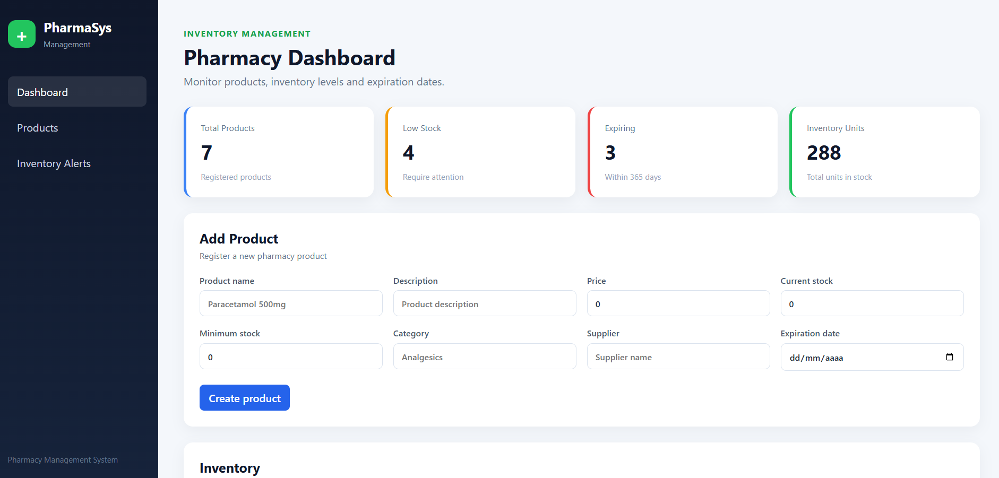
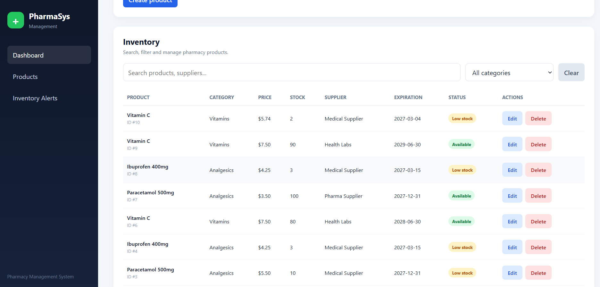
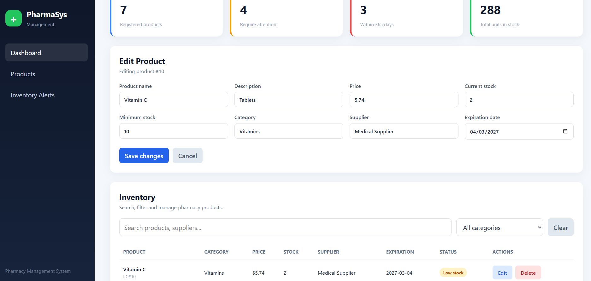
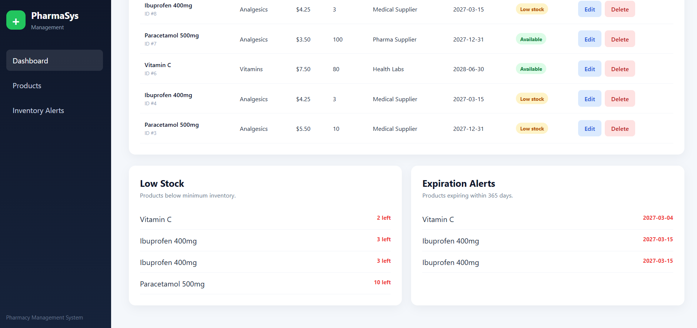

# Pharmacy Management System

Full-stack pharmacy inventory management system built with FastAPI, MySQL, React, and TypeScript.

The application provides product, category, supplier, and inventory management through a REST API connected to a responsive frontend dashboard.

## Features

- Create, read, update, and delete products
- Search products
- Filter products by category
- Low-stock detection
- Expiring-product alerts
- Category management
- Supplier management
- Inventory overview
- REST API
- Responsive frontend dashboard
- Centralized backend error handling
- Backend automated tests
- Frontend automated tests

## Technologies

### Backend

- Python
- FastAPI
- SQLAlchemy
- PyMySQL
- MySQL
- Pytest

### Frontend

- React
- TypeScript
- Vite
- Vitest
- Testing Library

### Development

- Git
- GitHub

## Project Structure

```text
pharmacy-management-system/
├── backend/
│   ├── app/
│   ├── tests/
│   ├── .env.example
│   ├── pyproject.toml
│   └── requirements.txt
│
├── frontend/
│   ├── public/
│   ├── src/
│   ├── package.json
│   └── vite.config.ts
│
├── docs/
│   └── screenshots/
│
├── .gitignore
└── README.md
```

## Architecture

The backend follows a layered architecture:

```text
API / Routers
      ↓
Services
      ↓
Repositories
      ↓
SQLAlchemy
      ↓
PyMySQL
      ↓
MySQL
```

This separation keeps API routing, business logic, and database access organized independently.

## API Capabilities

The backend supports:

- Get all products
- Get product by ID
- Create products
- Update products
- Delete products
- Search products
- Filter products by category
- Retrieve low-stock products
- Retrieve expiring products
- Manage categories
- Manage suppliers

## Environment Configuration

The backend uses environment variables for database configuration.

Create:

```text
backend/.env
```

using:

```text
backend/.env.example
```

as a reference.

The real `.env` file is excluded from version control.

## Running the Backend

From the project root:

```bash
cd backend
```

Activate the Python virtual environment.

On Git Bash:

```bash
source .venv/Scripts/activate
```

Install dependencies:

```bash
python -m pip install -r requirements.txt
```

Run the API:

```bash
python -m uvicorn app.main:app --reload
```

The API will be available at:

```text
http://127.0.0.1:8000
```

Swagger documentation:

```text
http://127.0.0.1:8000/docs
```

## Running Backend Tests

From the `backend` directory:

```bash
python -m pytest
```

## Running the Frontend

Open another terminal:

```bash
cd frontend
```

Install dependencies:

```bash
npm install
```

Start the development server:

```bash
npm run dev
```

The frontend is normally available at:

```text
http://localhost:5173
```

## Running Frontend Tests

```bash
npm test -- --run
```

## Production Build

```bash
npm run build
```

## Security and Configuration

The project includes several basic security and configuration practices:

- Environment variables are excluded from Git
- Database credentials remain outside the source code
- SQLAlchemy handles database operations
- CORS is explicitly configured
- Backend exceptions use centralized error handling
- Input data is validated through API schemas

## Screenshots

### Dashboard



### Product Management



### Product Form



### Inventory Alerts



## Testing

The project includes automated testing for both application layers:

- Backend API tests with Pytest
- Frontend component tests with Vitest and Testing Library

The frontend is also verified through a production build using TypeScript and Vite.

## Future Improvements

Possible future improvements include:

- Authentication
- Role-based authorization
- Docker support
- Cloud deployment
- Audit logs
- Expanded test coverage
- Dedicated category and supplier management interfaces

## Project Status

Version 1.0.0 represents the first complete portfolio-ready version of the Pharmacy Management System.